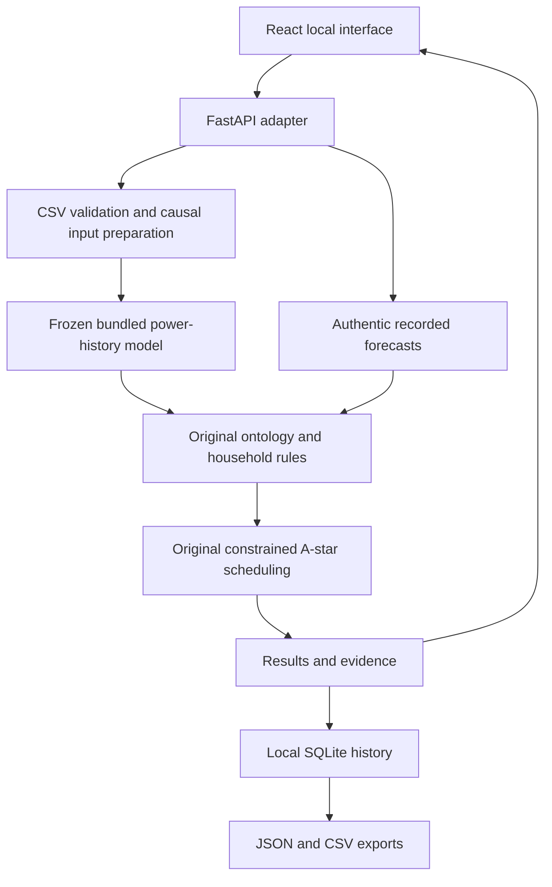

# Integration and architecture audit

Starting source: `Gauravch-dev/cil`, `main`, revision `daaf4131`.
The original repository exposed notebook dashboards rather than an HTTP frontend.
The new adapter preserves original task sources, ontology, trained artifacts and
recorded metrics. User-provided context was reference material; executable source
and matching artifacts determine the implemented behavior.

## Architecture

`web_api.py` exposes the HTTP routes, serializes access to analysis, persists
results and serves `frontend/dist` after the API routes. The React/TypeScript
frontend uses the same-origin API; Vite provides a loopback development proxy.
`readings.py` treats uploads solely as CSV data. `local_forecast.py` performs
frozen inference with trusted repository artifacts and original preprocessing.
No deployment or training route is introduced.

## Original task coverage

| Component | Source | Integration and boundary |
| --- | --- | --- |
| 1: knowledge representation | `SmartElectricityOptimizer.owl`, `OntologyKnowledge` | Loads the actual ontology; types, candidate decisions and asserted examples appear in evidence. |
| 2: reasoning | `task9_core.reason_appliance` and original reasoning notebook | Executes essential, occupancy, comfort, requested-state, priority/running, flexibility and fixed-job rules unchanged; ordered traces remain visible. Earlier standalone experiments remain offline. |
| 3: search | `task9_core.plan_jobs`, original search notebook | Uses the integrated constrained A* planner with deadlines, durations and concurrency. Earlier BFS/DFS/greedy comparisons remain offline. |
| 4–6: data and baseline work | Original notebooks and saved power/prepared arrays | Reuses authentic history and preprocessing provenance; training and algorithm-comparison experiments are not customer UI screens. |
| 7: forecasting | Completed `task7_outputs/full_20261004T223051_253137Z`, `task7_pipeline.py` | Recorded examples use exact saved LSTM values. Upload/sample inference executes the bundled older power-history model with matching preprocessing/scalers. Missing newer multivariate/hybrid artifacts are not claimed present. |
| 8: explanation | `task8_outputs/run_20261004T224434_997783Z` | Three recorded cases have exact timestamp/run/prediction-matched saved integrated gradients and reconstruction checks. Unmatched cases and arbitrary uploads do not receive invented contributions. Optional newer bridge SHAP is checked for reconstruction when available. |
| 9: integrated optimizer | `task9_core.py`, original dashboard and pipeline | Household/appliance settings, validation, threshold feedback, rules, scheduling, job-cost comparison, history and exports wrap original behavior. |
| 10: evaluation | Original Task 10 sources, notebooks and validation files | Retained offline and unchanged. Synthetic validation fixtures are not presented as successful real-data evaluation. New adapter checks are separate. |

## Forecast paths

### Recorded examples

The default 67 cases use authentic `lstm_compact_kW` values and original dates
from the completed older run. History and any saved explanation are aligned to
that exact source. Submitted household values still run through original rules
and search; they do not turn an old forecast into a current household estimate.

### New uploaded inference

The completed bundled older model receives 96 completed 15-minute history steps
with six channels and 17 context features. `local_forecast.py` extracts only the
trusted original preprocessing definitions, loads frozen power/context scalers
and Keras weights, checks dimensions/order and reproduces five saved forecasts
before reporting readiness. It never executes top-level training code.

The original active-power history and context reconstruction are checked against
saved arrays. Other uploaded electrical channels are validated but are not inputs
to this older model. Inference uses only past meter values and known calendar
features for the future target. No future measured label is required or invented.
The source run and model SHA-256 are retained in the forecast.

### Explicit synthetic samples

Marked complete synthetic files can be requested with `sample_forecast=true`.
They retain their original dates and set `forecast.is_sample=true`; the home
page, chart, history and JSON preserve sample identity. This separate request
does not bypass the actual-current path's freshness requirement. An unmarked or
incomplete file cannot use the sample flag to masquerade as valid sample data.
The built-in sample has 11,520 rows for 1–8 January 2026 UTC; its next target is
00:45–01:00 on 9 January.

### Optional newer bridge

`CIL_TASK7_FOLDER` and `CIL_TASK9_OUTPUT` may select a matching completed newer
model and exact hybrid cache. Startup blocks fitting both candidate regressors
on cache misses. If unavailable, authentic recorded examples and the bundled
older upload adapter remain the supported paths. Newer multivariate/peak-gated
inference was not verified with real matching artifacts because they are absent.
An older model filename cannot be renamed to satisfy that different input contract.

## Semantics preserved

- Forecast units: average **kW for one 15-minute interval ending one hour after origin**.
- Occupancy, temperature, tariffs and appliance preferences guide rules/costs;
  they do not rewrite the meter-based forecast.
- The saved training-derived demand threshold is used unchanged.
- Named ontology-essential identities remain protected even if an editable flag
  changes. Inferred candidates and final ordered rule decisions stay distinct.
- Empty-home behavior and the occupied-home AC comfort rule at 38°C are preserved.
- Planning uses 15-minute increments, declared runtimes, start/deadline windows,
  horizon and scheduled-job concurrency. Protected loads are separate.
- Peak-window avoidance applies to the one high-demand target interval.
- Cost comparison uses a feasible earliest-start plan under the same constraints.
  It covers scheduled jobs, not whole-house bills or measured savings.
- Infeasible/search-limited outcomes keep their actual status and available evidence.
- Equal peak start/end and overnight tariff windows retain original behavior.

## Input, storage and local boundaries

The upload limit is 10 MB, 100,000 rows and 60 days. Current estimates require
eight days of minute readings, a usable complete seven-measurement interval
within 30 minutes, 96 finite recent intervals and finite daily/weekly context.
Future/duplicate/malformed/ambiguous local timestamps are rejected. Missing
measurements receive only the original four-bin past-only forward filling.
Every analysis rechecks stored data; stale uploads cannot use an old readiness flag.

SQLite operations use parameters. Filenames are sanitized metadata rather than
filesystem destinations. The local database stores CSV bytes and full saved
analyses and is excluded from Git. Tests use temporary databases, not user history.
CSV exports neutralize formula prefixes. Writes reject other origins except the
same origin and the declared local Vite origins. No permissive CORS is enabled.
The launcher binds loopback and adds no hosting configuration.

## Known limits

- No calibrated forecast confidence percentage or individual prediction interval.
- Saved prediction contributions cover only three exact recorded histories;
  arbitrary uploaded forecasts have no verified contribution breakdown.
- No live meter/utility account connection, appliance switching, authentication,
  multi-user isolation, cloud history or public deployment.
- No established accuracy on a new user's household, independent current meter
  validation or measured bill savings. Timestamp checks do not prove authenticity.
- No complete new real-data Task 10 evaluation, demographic/fairness certification
  or real matching-artifact verification of the optional newer hybrid.

See [API contracts](docs/API.md), [setup](README_WEB.md) and the
[verification record](docs/VERIFICATION.md) for commands and evidence. Existing
notebooks and task documentation remain the references for original offline work.
